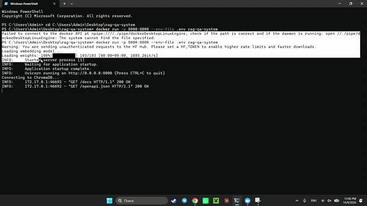
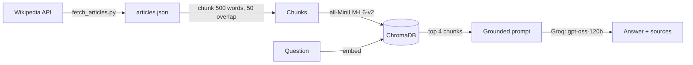

# Kazakh Culture RAG Q&A System

[](https://github.com/AlibekBerik/rag-qa-system/actions/workflows/tests.yml)


A Retrieval-Augmented Generation (RAG) system that answers questions about Kazakh nomadic traditions, music and customs, grounded in real Wikipedia articles rather than model guesses. Ask something outside its knowledge base and it says so instead of making something up.



## How it works



1. **Fetch**: pulls Wikipedia articles on Kazakh culture (nomadic pastoralism, yurts, the dombra, Nauryz, cuisine, eagle hunting, the Kazakh Khanate and more).
2. **Chunk**: splits each article into overlapping ~500-word chunks, so retrieval finds specific passages instead of whole articles.
3. **Embed**: turns each chunk into a vector with `sentence-transformers` (`all-MiniLM-L6-v2`).
4. **Store**: saves the vectors in a local ChromaDB database.
5. **Retrieve**: embeds the question the same way and fetches the 4 most similar chunks.
6. **Generate**: sends the question and chunks to an LLM (Groq, `openai/gpt-oss-120b`) with an instruction to answer *only* from that context, and to say so when the context doesn't contain the answer.

## Example

**Q: What do Kazakhs eat traditionally?**
> Traditionally Kazakh food is centered on meat and dairy: large pieces of boiled horse or mutton (besbarmak), offal dishes like quwyrdaq, and fermented mare's milk (kumys)...

*Sources: Kazakh cuisine, Kazakhs, Kazakh clothing*

**Q: What is the capital of France?**
> I don't have enough information.

## Tests

| Suite | What it checks | Runs in CI |
|---|---|---|
| `tests/test_chunking.py` | Chunk size, overlap, full coverage of the text, no duplicate tail chunk, invalid settings | Yes |
| `tests/test_api.py` | `/ask` flow, source de-duplication, and that the prompt carries the retrieved context and the refusal rule | Yes (models replaced by stand-ins) |
| `tests/test_refusal_live.py` | 5 out-of-scope questions must each be refused by the real model | No: needs a Groq key |

```bash
pip install -r requirements-dev.txt
pytest                                    # unit + API tests
GROQ_API_KEY=your_key pytest -m live      # live refusal tests (needs a built chroma_db)
```

## Running it yourself

Create a `.env` file with your own Groq API key:

```
GROQ_API_KEY=your_key_here
```

Build the vector database (only needed once, takes under a minute):

```bash
pip install -r requirements.txt
python fetch_articles.py
python build_index.py
```

### With Docker (recommended)

```bash
docker build -t rag-qa-system .
docker run -p 8000:8000 --env-file .env rag-qa-system
```

### Without Docker

```bash
python -m venv venv
venv\Scripts\activate        # Windows (macOS/Linux: source venv/bin/activate)
pip install -r requirements.txt
uvicorn api:app --reload
```

Then open `http://127.0.0.1:8000/docs` and try the `/ask` endpoint. `demo_retrieval.py` prints the raw chunks retrieved for one question, which is useful for checking retrieval on its own.

## Tech stack

Python · FastAPI · ChromaDB · sentence-transformers · Groq API · Docker · pytest · GitHub Actions

## Note on data

`chroma_db/` (the built vector database) isn't included, to keep the repo light. Running `fetch_articles.py` and then `build_index.py` rebuilds it locally.
